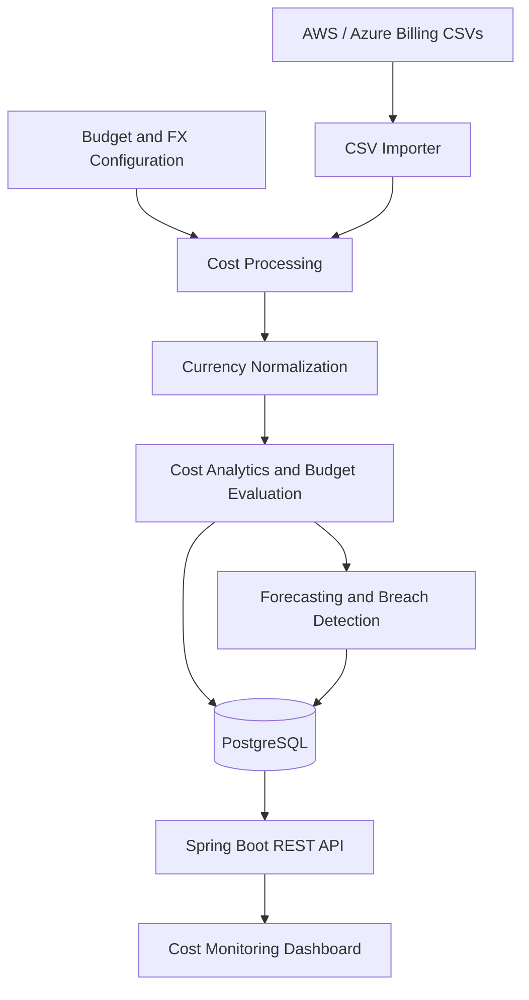

# Bill Radar

**Cloud Cost Monitoring and Budget Forecasting**

Bill Radar is a cloud cost visibility application that imports billing data from AWS-style and Azure-style CSV exports, normalizes costs into a reporting currency, tracks spending against configured budgets, and estimates potential budget breaches.

The goal is to make cloud spending easier to understand and help teams identify cost overruns before they become surprises.

## Key Features

- **Billing data ingestion:** Import cloud billing records from CSV files.
- **Cost normalization:** Convert supported billing currencies into a common reporting currency.
- **Spending analytics:** View month-to-date spending and analyze costs across services and resource groups.
- **Budget monitoring:** Compare actual spending against configured budgets.
- **Budget forecasting:** Estimate projected spending and flag potential budget breaches.
- **Untagged cost visibility:** Identify spending associated with resources that lack the expected tags.
- **REST API:** Expose cost summaries and analytics to the dashboard.
- **Automated testing:** Validate core application behavior with automated tests.

## Live Demo

**Live Application:** [Bill Radar Dashboard](https://bill-radar.onrender.com/)

**API Endpoint:** [Cost Summary API](https://bill-radar.onrender.com/api/costs/summary)

Bill Radar is deployed on Render with a PostgreSQL database. The demo uses sample AWS-style and Azure-style billing data to demonstrate cost analytics, budget monitoring, and spending forecasts.

## Architecture



### How the application works

1. **Import:** Billing records are read from CSV files and validated.
2. **Normalize:** Accepted records are converted into the configured reporting currency using the configured exchange-rate values.
3. **Persist:** Processed billing data is stored in PostgreSQL.
4. **Analyze:** The application calculates spending summaries, identifies untagged costs, and evaluates budget utilization.
5. **Forecast:** Spending projections are compared with configured budgets to identify potential breaches.
6. **Present:** The REST API supplies the data used by the dashboard.

## Technology Stack

| Area | Technology |
|---|---|
| Language | Java 21 |
| Backend framework | Spring Boot |
| API layer | REST APIs |
| Database | PostgreSQL |
| Persistence | Spring Data JPA / Hibernate |
| Build and dependency management | Maven |
| Local infrastructure | Docker Compose |
| Testing | JUnit and the project's configured test dependencies |
| Billing ingestion | CSV processing |
| Cost intelligence | Currency normalization, budget evaluation, and spending forecasts |

## Prerequisites

For local development:
- Java 21
- Docker Desktop with Docker Compose
- Git

The Maven Wrapper (`mvnw`) is included, so a separate Maven installation is not required.

To run Bill Radar as a container, Docker Desktop is sufficient for building and running the application image. PostgreSQL must still be available separately.

## Getting Started

### 1. Clone the repository

```bash
git clone https://github.com/Sms1818/bill-radar.git
cd bill-radar
```

### 2. Configure environment variables

Create a file named `.env.local` manually in the project root, alongside `pom.xml` and `compose.yaml`.

Add the following variables:

```dotenv
DB_URL=jdbc:postgresql://localhost:5433/bill_radar
DB_USERNAME=bill_radar
DB_PASSWORD=bill_radar_dev
```

The default local development credentials match the PostgreSQL configuration in `compose.yaml`. If you change the database credentials, update both `.env.local` and the corresponding PostgreSQL environment variables in `compose.yaml`.

**Important:** Spring Boot does not automatically load `.env.local`. Before running Maven, load the variables into your current terminal session:

```bash
set -a
source .env.local
set +a
```

The application uses these variables to configure its database connection.

The `.env.local` file is excluded from Git. Never commit real credentials, API keys, or production secrets.

### 3. Start PostgreSQL

From the project root, run:

```bash
docker compose up -d
```

The local application connects to PostgreSQL through port `5433` on your machine. The database container uses its own PostgreSQL port, `5432`.

Check the container status:

```bash
docker compose ps
```

### 4. Run the automated tests

Load the environment variables if you have opened a new terminal session:

```bash
set -a
source .env.local
set +a
```

Then run:

```bash
./mvnw test
```

The test suite validates the application's implemented behavior. Tests that require external infrastructure may need the relevant dependencies to be available.

### 5. Start the application

With PostgreSQL running and the environment variables loaded:

```bash
./mvnw spring-boot:run
```

Once the application starts, open:

**http://localhost:8080**

The dashboard uses the Spring Boot application to access the backend API.

## Running with Docker

Bill Radar includes a multi-stage `Dockerfile` that builds the Spring Boot application with Java 21 and packages it into a Java runtime image. The following instructions are for local Docker testing. Production deployments require the appropriate database connection and environment variables.

### Build the image

From the project root:

```bash
docker build -t bill-radar .
```

### Start PostgreSQL

Start the local PostgreSQL service using Docker Compose:

```bash
docker compose up -d
```

### Run the application container

Ensure PostgreSQL is running through Docker Compose and your `.env.local` variables are loaded into the terminal. The database URL below is specific to the local development setup.

Then run:

```bash
docker run --rm \
  --name bill-radar \
  -p 8080:8080 \
  -e DB_URL="jdbc:postgresql://host.docker.internal:5433/bill_radar" \
  -e DB_USERNAME="$DB_USERNAME" \
  -e DB_PASSWORD="$DB_PASSWORD" \
  bill-radar
```

The `host.docker.internal` hostname allows the application container to connect to PostgreSQL exposed on the host machine.

Open **http://localhost:8080** to access the dashboard.

Stop the application container with `Ctrl+C`. PostgreSQL can be stopped separately using `docker compose down`.

## Configuration and Sample Data

### Budget configuration

Budget settings are maintained in:

`sample-data/budgets.json`

The configuration defines the reporting currency, budget thresholds, and exchange-rate values used by the application.

The included sample configuration uses EUR as the reporting currency. Its exchange rates are illustrative values for the demo, not live foreign-exchange rates.

### Sample billing files

The `sample-data/` directory includes:

- `aws_cur_style.csv` — AWS-style billing records.
- `azure_cost_style.csv` — Azure-style billing records.
- `budgets.json` — budget and currency configuration.

These files make it possible to explore the application's cost-processing workflow without connecting a live cloud account.

### Example API endpoint

Retrieve the cost summary:

```http
GET http://localhost:8080/api/costs/summary
```

The summary includes month-to-date spending, untagged spending, record counts, budget information, and projected spending where supported by the implementation.

## Stopping the Application

Stop the Spring Boot process with `Ctrl+C`.

To stop PostgreSQL and the other Compose services:

```bash
docker compose down
```

This stops the containers without intentionally deleting the database's persisted volume.

Avoid `docker compose down -v` unless you explicitly want to remove the associated volumes and potentially lose local database data.

## Current Scope and Limitations

Bill Radar is currently a **sample-data-driven cost monitoring MVP**.

- Billing records are imported from CSV files rather than fetched from live AWS or Azure accounts.
- Currency conversion uses configured exchange rates.
- Forecasts are estimates based on the implemented forecasting logic.
- Authentication, multi-tenant isolation, and production-grade access control are not claimed as implemented features.
- Live alerts, cloud-provider synchronization, and production deployment integrations remain future work.

These boundaries are intentional: the current application focuses on demonstrating the core billing ingestion, cost analysis, and budget-monitoring workflow.

## Future Roadmap

### Phase 1: Production-ready foundations

- Add authentication and role-based authorization.
- Introduce tenant-aware data isolation for multiple organizations.
- Validate and version budget configuration.
- Improve API error handling, input validation, and structured logging.
- Add database migrations and stronger integration-test coverage where needed.

### Phase 2: Live cloud billing integrations

- Integrate with AWS Cost Explorer and supported AWS billing exports.
- Integrate with Azure Cost Management.
- Securely manage cloud credentials and permissions.
- Schedule billing synchronization and support incremental imports.
- Track import status, failures, retries, and duplicate records.

### Phase 3: Cost alerts and anomaly detection

- Configure budget thresholds at account, service, and project levels.
- Send email or webhook alerts when spending crosses a threshold.
- Detect unusual spending increases and unexpected resource costs.
- Maintain alert history and prevent duplicate notifications.
- Add configurable alert severity and escalation policies.

### Phase 4: AI-Powered Cost Intelligence

- **Natural-Language Cost Analysis:** Let users query cloud spending and understand cost drivers using LLMs.
- **AI-Powered Insights:** Explain spending anomalies, budget overruns, and unusual cost patterns.
- **Intelligent Cost Optimization:** Suggest potential cost-saving opportunities based on billing data.
- **RAG-Based Cost Assistant:** Retrieve relevant billing records and historical summaries to provide context-aware, evidence-backed answers.
- **Predictive Budget Intelligence:** Improve spending forecasts and identify potential budget breaches earlier.

Engineering considerations: Keep financial calculations, budget thresholds, and currency conversions deterministic. Use AI for interpreting results, explaining patterns, and generating recommendations rather than relying on an LLM to perform authoritative financial calculations. Validate model outputs, enforce access controls, and track AI usage and failures.

### Phase 5: Operational visibility and deployment

- Improve container security and optimize production deployments.
- Add CI checks for tests, formatting, and build failures.
- Introduce application health checks and metrics.
- Add dashboards for API performance, import failures, and database health.
- Deploy the application with managed PostgreSQL and production environment configuration.

## Contributing

1. Create a branch for your change.
2. Keep changes focused and add tests for new behavior.
3. Run `./mvnw test` before opening a pull request.
4. Never commit local environment files, credentials, or sensitive billing data.

## License

No license has been specified yet. Until one is added, do not assume that the repository grants permission to reuse or redistribute its code.
